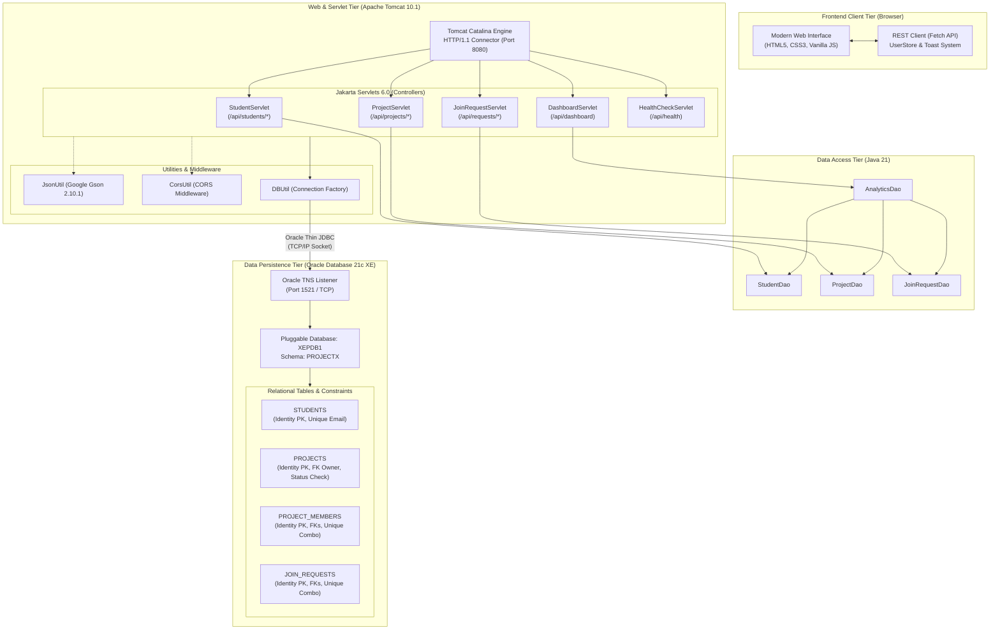
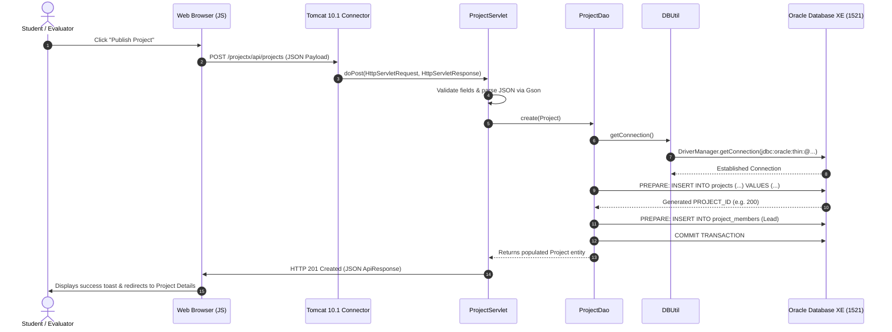

# ProjectX - System Architecture & Engineering Design

## 1. Executive Architecture Summary

**ProjectX - Student Project Exchange** is a production-grade multi-tier web application built following the classical **Model-View-Controller (MVC)** and **Data Access Object (DAO)** enterprise architectural patterns. It runs on an **Apache Tomcat 10.1** application container, powered by **Java 21 (OpenJDK)**, **Jakarta Servlets 6.0**, and communicates directly with a local **Oracle Database 21c Express Edition (XE)** instance over high-performance Oracle Thin JDBC (`ojdbc11`).

---

## 2. Layer-by-Layer Architectural Breakdown

### 2.1 Presentation Tier (Frontend)
- **HTML5 & Vanilla JavaScript**: Zero reliance on heavyweight frontend frameworks (React, Angular, Vue) ensures zero build-step overhead, rapid initial byte delivery, and full browser compatibility.
- **Custom CSS3 Design System**:
  - Implements cohesive CSS variables (`--primary: #4f46e5`, `--navy: #0f172a`, etc.) creating a modern student-tech aesthetic.
  - Fully responsive grid and flexbox layouts supporting mobile screens, tablets, and desktop workstations.
  - Interactive toast notification system (`Toast.show()`) and smooth animated modal dialogs (`Modal.open()`).
- **REST Communication (Fetch API)**:
  - Standardized JSON exchange using native `window.fetch()`.
  - Automatic base path resolution (`/projectx/api` vs `/api`).
  - Centralized request wrapper with HTTP error classification.
- **Demo Identity Selector (`UserStore`)**:
  - Persistent client-side demo state stored in browser `localStorage`.
  - Allows an evaluator to toggle active student personas (e.g. from *Aarav Sharma* to *Priya Patel*) in real time.
  - Automatically dispatches custom browser event `projectx:userChanged` to re-query role-dependent data dynamically without full-page reload.

### 2.2 Controller Tier (Jakarta Servlets 6.0)
- **Servlet Specification**: Uses `jakarta.servlet.*` (Jakarta EE 10 / Servlet API 6.0) targeting Apache Tomcat 10.1+.
- **RESTful Dispatching**:
  - `StudentServlet`: Handles collection (`/api/students`) and resource-by-ID (`/api/students/{id}`) for full CRUD operations.
  - `ProjectServlet`: Supports comprehensive multi-field filtering (`search`, `category`, `status`, `tech`, `ownerId`).
  - `JoinRequestServlet`: Coordinates join requests and transactional status state machines.
  - `DashboardServlet`: Gathers high-level aggregation metrics and personalized activity feeds.
  - `HealthCheckServlet`: Queries live Oracle Database metadata and reports driver and service health.
- **Serialization & Data Validation**:
  - Employs **Google Gson 2.10.1** with custom `Timestamp` type adapters for ISO-standard date formatting.
  - Centralized cross-origin handling via `CorsUtil` supporting standard CORS headers and `OPTIONS` preflight requests.

### 2.3 Data Access Tier (DAO Pattern)
- Decouples business logic and HTTP handlers from underlying SQL dialects.
- **Strict Parameterized Queries**: Every database interaction uses `java.sql.PreparedStatement` to eliminate SQL injection vulnerabilities.
- **Transactions & Atomicity**: Multi-step business operations (such as project creation automatically enrolling the creator as "Project Lead", or accepting a join request automatically inserting a row into `PROJECT_MEMBERS`) execute inside explicit database transactions with atomic `commit()` and `rollback()` handling.

### 2.4 Persistence Tier (Oracle Database 21c XE)
- **Pluggable Database Architecture**: Installed in dedicated PDB `XEPDB1` under the unprivileged schema user `PROJECTX`.
- **Identity Columns & Sequences**: Utilizes Oracle 21c `GENERATED BY DEFAULT AS IDENTITY` columns, with sequences aligned past initial seed data.
- **Referential Integrity**: Enforces foreign keys with `ON DELETE CASCADE`, check constraints for domain-restricted statuses, and unique constraints preventing duplicate emails or repeated join requests.

---

## 3. Request-Response Lifecycle Sequence

