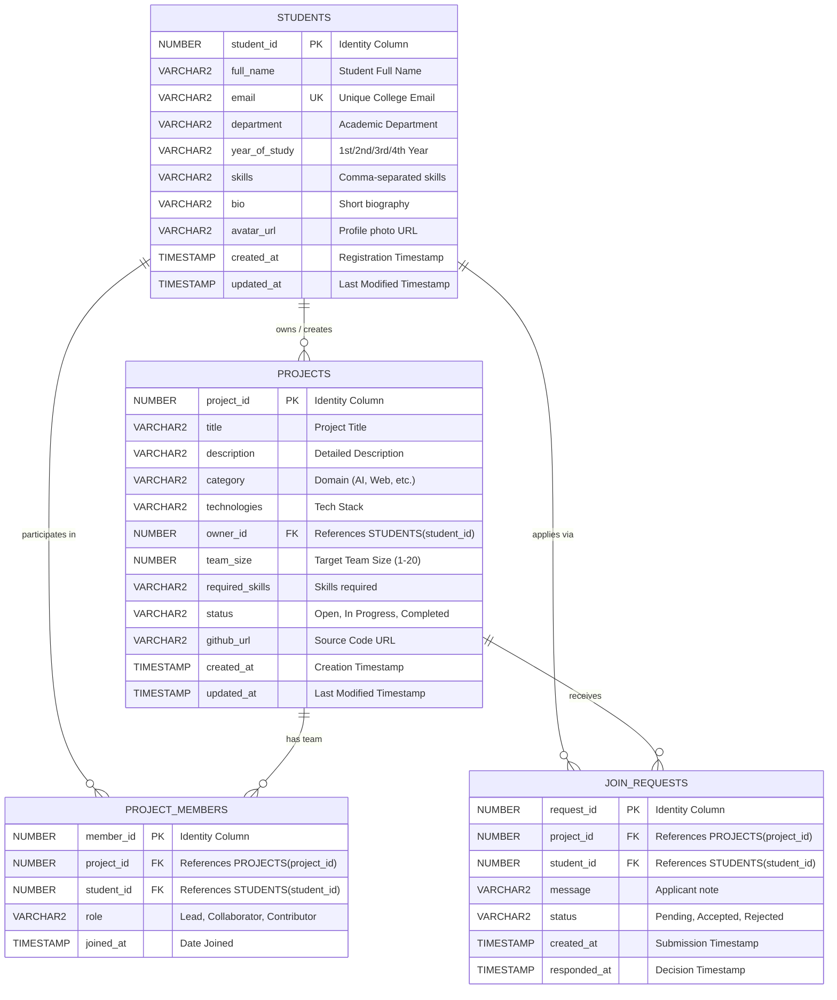

# ProjectX - Database Design & Schema Specification

## 1. Overview
ProjectX uses a normalized relational schema deployed on **Oracle Database 21c Express Edition (XE)**. The schema enforces data integrity through primary keys, foreign key constraints with cascade options, check constraints for enumerated domains, and unique constraints preventing duplicate data entry.

---

## 2. Entity-Relationship Diagram (ERD)

---

## 3. Data Dictionary

### Table 1: `STUDENTS`
| Column | Type | Constraints | Description |
| :--- | :--- | :--- | :--- |
| `student_id` | NUMBER | PK, IDENTITY | Auto-incrementing primary key |
| `full_name` | VARCHAR2(100) | NOT NULL | Complete student name |
| `email` | VARCHAR2(120) | NOT NULL, UNIQUE | University email address |
| `department` | VARCHAR2(100) | NOT NULL | Engineering department |
| `year_of_study`| VARCHAR2(30) | NOT NULL | Academic classification |
| `skills` | VARCHAR2(500) | NULLABLE | Primary technical skills |
| `bio` | VARCHAR2(1000) | NULLABLE | Academic and technical background |
| `avatar_url` | VARCHAR2(255) | NULLABLE | Web URL for profile avatar |
| `created_at` | TIMESTAMP | DEFAULT CURRENT_TIMESTAMP | Record creation time |
| `updated_at` | TIMESTAMP | DEFAULT CURRENT_TIMESTAMP | Last updated time |

### Table 2: `PROJECTS`
| Column | Type | Constraints | Description |
| :--- | :--- | :--- | :--- |
| `project_id` | NUMBER | PK, IDENTITY | Auto-incrementing primary key |
| `title` | VARCHAR2(200) | NOT NULL | Project title |
| `description` | VARCHAR2(3000) | NOT NULL | Full project description |
| `category` | VARCHAR2(100) | NOT NULL | Primary category/domain |
| `technologies` | VARCHAR2(500) | NOT NULL | Technologies and libraries |
| `owner_id` | NUMBER | NOT NULL, FK `STUDENTS` | Student who created the project |
| `team_size` | NUMBER | NOT NULL, CHECK (1..20) | Target maximum team capacity |
| `required_skills`| VARCHAR2(500)| NOT NULL | Skills sought from collaborators |
| `status` | VARCHAR2(30) | NOT NULL, CHECK (Open/In Progress/Completed) | Lifecycle state |
| `github_url` | VARCHAR2(255) | NULLABLE | Remote git repository link |
| `created_at` | TIMESTAMP | DEFAULT CURRENT_TIMESTAMP | Publication timestamp |
| `updated_at` | TIMESTAMP | DEFAULT CURRENT_TIMESTAMP | Last modification timestamp |

### Table 3: `PROJECT_MEMBERS`
| Column | Type | Constraints | Description |
| :--- | :--- | :--- | :--- |
| `member_id` | NUMBER | PK, IDENTITY | Auto-incrementing primary key |
| `project_id` | NUMBER | NOT NULL, FK `PROJECTS` | Associated project |
| `student_id` | NUMBER | NOT NULL, FK `STUDENTS` | Enrolled student |
| `role` | VARCHAR2(50) | NOT NULL, DEFAULT 'Contributor' | Role on team (Lead/Collaborator) |
| `joined_at` | TIMESTAMP | DEFAULT CURRENT_TIMESTAMP | Enrolled timestamp |
| **Unique Key** | `(project_id, student_id)` | UNIQUE | Prevents duplicate enrollments |

### Table 4: `JOIN_REQUESTS`
| Column | Type | Constraints | Description |
| :--- | :--- | :--- | :--- |
| `request_id` | NUMBER | PK, IDENTITY | Auto-incrementing primary key |
| `project_id` | NUMBER | NOT NULL, FK `PROJECTS` | Target project |
| `student_id` | NUMBER | NOT NULL, FK `STUDENTS` | Applicant student |
| `message` | VARCHAR2(1000) | NULLABLE | Cover note explaining qualifications |
| `status` | VARCHAR2(30) | NOT NULL, CHECK (Pending/Accepted/Rejected) | Request workflow state |
| `created_at` | TIMESTAMP | DEFAULT CURRENT_TIMESTAMP | Submission timestamp |
| `responded_at` | TIMESTAMP | NULLABLE | Decision timestamp |
| **Unique Key** | `(project_id, student_id)` | UNIQUE | Prevents duplicate applications |

---

## 4. Normalization Analysis

### First Normal Form (1NF)
- Every table has a designated primary key (`student_id`, `project_id`, `member_id`, `request_id`).
- All column attributes hold atomic, single-valued entries at the relational level.
- No repeating groups or variable column arrays exist in the tables.

### Second Normal Form (2NF)
- All tables are in 1NF.
- Every non-key column is fully functionally dependent on the entire primary key, not on any partial subset (especially relevant as single-column surrogate keys are employed throughout).

### Third Normal Form (3NF)
- All tables are in 2NF.
- There are no transitive dependencies: non-key attributes depend only on the primary key, and not on other non-key attributes. For example, student details are stored exclusively in `STUDENTS`; project cards join student data through `owner_id` rather than duplicating name and email inside `PROJECTS`.

---

## 5. Performance Indexing Strategy
To optimize filtering, join operations, and foreign key traversals, the following B-tree indexes are implemented:
- `idx_proj_owner`: Index on `PROJECTS(owner_id)` for rapid lookup of student-owned projects.
- `idx_proj_category`: Index on `PROJECTS(category)` for domain filtering.
- `idx_proj_status`: Index on `PROJECTS(status)` for open projects queries.
- `idx_req_project` & `idx_req_student`: Indexes on `JOIN_REQUESTS` foreign keys.
- `idx_member_proj` & `idx_member_stud`: Indexes on `PROJECT_MEMBERS` foreign keys.
